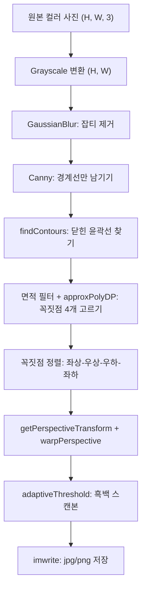
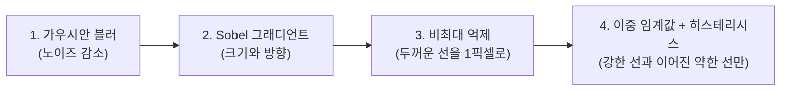

# A3-1 개념 정리 — 이미지 처리 파이프라인으로 만드는 문서 스캐너

대상: Python과 NumPy는 써 봤지만 컴퓨터 비전은 처음인 학습자<br>
기준 과제: [A3-1 과제 안내(subject.md)](../subject.md)<br>
함께 볼 문서: [단계별 실습 가이드(WALKTHROUGH.md)](WALKTHROUGH.md)

이 문서는 정답 코드를 알려 주는 문서가 아닙니다. 비스듬히 찍힌 종이 사진을 반듯한 스캔본으로 바꾸기까지 **각 단계에서 이미지에 무슨 일이 일어나는지**, 그리고 **왜 그 방법이 어떤 사진에서는 실패하는지**를 이해하도록 돕습니다. 실제 작업 순서는 [WALKTHROUGH.md](WALKTHROUGH.md)를 따라가면서, 막힐 때마다 이 문서의 해당 절로 돌아오면 됩니다.

## 읽는 순서

| 순서 | 배울 내용 | 이걸 알면 할 수 있는 일 |
| --- | --- | --- |
| 1 | 이미지 = NumPy 배열 | 사진을 읽고 크기·채널·픽셀 값을 확인하고 잘라 내기 |
| 2 | 색 공간과 그레이스케일 | 컬러 사진을 밝기 한 장으로 바꾸고 그 의미 설명하기 |
| 3 | 히스토그램과 밝기 분포 (EDA) | 쉬운 사진과 어려운 사진의 차이를 그래프로 보여 주기 |
| 4 | 컨볼루션과 가우시안 블러 | 블러 커널 크기가 결과에 주는 영향 설명하기 |
| 5 | 그래디언트와 Canny 엣지 | 임계값 low/high를 왜 그렇게 정했는지 설명하기 |
| 6 | 윤곽선과 다각형 근사 | 엣지 이미지에서 "꼭짓점 4개짜리 종이"를 골라내기 |
| 7 | 꼭짓점 정렬의 기하학 | 라이브러리 없이 좌상-우상-우하-좌하 순서 만들기 |
| 8 | 동차 좌표와 투시 변환 | 4점으로 기울어진 종이를 정면 사진으로 펴기 |
| 9 | 적응형 이진화 | 그림자가 있어도 글씨가 살아 있는 흑백 스캔본 만들기 |
| 10 | OpenCV GUI: 윈도우·트랙바·키 입력 | 파라미터를 실시간으로 바꾸며 단계별 결과 보기 |
| 11 | 정량 평가와 실패 분석 | 20장 성공률 표와 실패 원인 분석 쓰기 |
| 12 | 규칙 기반의 한계와 학습 기반 | 보고서 결론을 자신의 데이터로 쓰기 |
| 13 | 보너스 개념 | NumPy 컨볼루션, 종횡비 계산, PDF 저장 |

1~5는 "사진을 깨끗한 선 그림으로 바꾸는 단계", 6~9는 "선 그림에서 종이를 찾아 펴는 단계", 10~12는 "결과를 보고 평가하는 단계"입니다. 처음 읽을 때는 1~9의 비유와 손 계산 예시만 따라가도 충분합니다.

전체 파이프라인은 다음과 같습니다.



---

## 1. 이미지는 숫자가 담긴 3차원 배열이다

### 직관

사진을 아주 크게 확대하면 작은 색 타일(픽셀)이 바둑판처럼 놓여 있습니다. 각 타일에는 "파랑이 얼마, 초록이 얼마, 빨강이 얼마"라는 세 숫자가 적혀 있습니다. 컴퓨터에게 사진은 이 숫자 바둑판일 뿐입니다.

### 정의

OpenCV의 `cv2.imread()`가 돌려주는 컬러 이미지는 모양이 `(Height, Width, Channel)`인 NumPy 배열입니다.

| 축 | 의미 | 예 (세로로 찍은 1200만 화소 사진) |
| --- | --- | --- |
| 0번 축 `H` | 행 = 세로 방향 위치 (y) | 4032 |
| 1번 축 `W` | 열 = 가로 방향 위치 (x) | 3024 |
| 2번 축 `C` | 채널 = 색 성분 | 3 (B, G, R) |

- 자료형은 보통 `uint8`이고, 값의 범위는 0(가장 어두움)~255(가장 밝음)입니다.
- **OpenCV는 채널 순서가 B, G, R입니다.** Matplotlib은 R, G, B 순서로 그리므로 `plt.imshow`로 띄우기 전에 `cv2.cvtColor(img, cv2.COLOR_BGR2RGB)`가 필요합니다.
- 배열 인덱스는 `img[y, x]`, 즉 **행(y)이 먼저**입니다. 반대로 OpenCV 함수에 좌표나 크기를 넘길 때는 `(x, y)`, `(width, height)` 순서입니다. 이 차이가 이 과제에서 가장 흔한 버그 원인입니다.

```python
img = cv2.imread("images/easy_01.jpg")
print(img.shape, img.dtype)   # (4032, 3024, 3) uint8
print(img[0, 0])              # 왼쪽 위 픽셀의 [B, G, R]
crop = img[100:300, 50:250]   # y 100~299, x 50~249 영역 (복사가 아니라 뷰)
```

### 데이터 분석에서 배운 NumPy를 그대로 쓴다

| NumPy 기법 | 이미지에서의 의미 |
| --- | --- |
| 슬라이싱 `img[y1:y2, x1:x2]` | 영역 잘라 내기 |
| `img.mean()`, `img.std()` | 평균 밝기, 대비(밝기 퍼짐 정도) |
| 불리언 마스크 `img > 200` | 밝은 픽셀만 고르기 |
| `np.clip`, `astype` | 값 범위 제한, 자료형 바꾸기 |
| 브로드캐스팅 `img * 0.5` | 전체 밝기 조절 |

### 흔한 오해

- **"`uint8`끼리 더하면 그냥 커진다"** — 아닙니다. NumPy에서 `np.uint8(250) + np.uint8(10)`은 260이 아니라 4가 됩니다(256으로 나눈 나머지). OpenCV의 `cv2.add`는 255에서 멈춥니다(포화 연산). 직접 계산할 때는 `astype(np.float32)`로 바꾼 뒤 계산하고 마지막에 `np.clip(...).astype(np.uint8)`로 되돌립니다.
- **"`imread`가 실패하면 에러가 난다"** — 아닙니다. 경로가 틀리면 조용히 `None`을 돌려줍니다. 그 뒤 `.shape`에서 `AttributeError`가 납니다. 읽은 직후 `None`인지 확인하는 습관을 들입니다. Windows에서 한글이 들어간 경로는 `imread`가 읽지 못하는 경우가 있습니다(`np.fromfile` + `cv2.imdecode`로 우회).

---

## 2. 색 공간과 그레이스케일

### 직관

흑백 복사기는 색은 버리고 "얼마나 밝은가"만 남깁니다. 종이 경계를 찾는 데는 색보다 **밝기 차이**가 중요하므로 첫 단계에서 그레이스케일로 바꿉니다. 데이터가 3분의 1로 줄어 처리도 빨라집니다.

### 정의

OpenCV의 `cv2.COLOR_BGR2GRAY` 변환은 사람 눈이 초록에 가장 민감하다는 점을 반영한 가중 평균입니다.

$$Y = 0.299R + 0.587G + 0.114B$$

### 손 계산

픽셀 값이 `[B, G, R] = [30, 200, 100]`(초록빛)이라면

$$Y = 0.299 \times 100 + 0.587 \times 200 + 0.114 \times 30 = 29.9 + 117.4 + 3.42 = 150.72 \approx 151$$

단순 평균 $(30+200+100)/3 = 110$과 꽤 다릅니다. 초록이 밝게 느껴지는 사람의 감각을 반영한 결과입니다.

### 과제와의 연결

- 기능 요구 3의 첫 단계입니다. 결과 배열의 모양은 `(H, W)`로 채널 축이 사라집니다.
- 이후의 `GaussianBlur`, `Canny`, `adaptiveThreshold`는 모두 이 한 채널 이미지에서 동작합니다. 특히 `adaptiveThreshold`는 **8비트 1채널** 이미지만 받습니다.

---

## 3. 히스토그램과 밝기 분포 (EDA)

### 직관

반 학생들의 키를 구간별로 세어 막대그래프로 그리면 "대부분 어디에 몰려 있는지"가 보입니다. 이미지 히스토그램은 같은 일을 픽셀 밝기로 합니다. 가로축은 밝기 0~255, 세로축은 그 밝기를 가진 픽셀 수입니다.

### 정의와 요약 통계

- `cv2.calcHist([gray], [0], None, [256], [0, 256])` 또는 `np.histogram(gray, bins=256, range=(0, 256))`
- 평균 $\mu = \frac{1}{N}\sum_i I_i$ : 전체적으로 밝은가 어두운가
- 표준편차 $\sigma = \sqrt{\frac{1}{N}\sum_i (I_i - \mu)^2}$ : 밝기가 얼마나 넓게 퍼져 있는가 = **대비(contrast)**

### 히스토그램 모양 읽기

| 모양 | 보통의 촬영 상황 | 엣지 검출에 주는 의미 |
| --- | --- | --- |
| 봉우리 두 개가 멀리 떨어짐 | 어두운 책상 + 흰 종이, 조명 균일 | 종이 경계의 밝기 차이가 커서 쉽다 |
| 왼쪽(어두운 쪽)에 좁게 몰림 | 실내 저조도, 역광 | 모든 차이가 작아져 경계가 약하다 |
| 봉우리가 셋 이상 | 그림자 영역과 밝은 영역이 섞임 | 그림자 경계가 종이 경계만큼 강해진다 |
| 넓게 고르게 퍼짐 | 무늬가 많은 복잡한 배경 | 종이 외의 엣지가 너무 많다 |

### "왜 어두운 이미지에서 엣지 검출이 어려운가" — 분포 관점

엣지는 "이웃한 픽셀의 밝기 차이가 큰 곳"입니다(5절). 그런데 어두운 사진은 히스토그램 전체가 좁은 구간(예: 10~60)에 몰려 있으므로, **어떤 두 픽셀을 골라도 차이가 작습니다.** 종이(40)와 책상(15)의 차이가 25밖에 안 되는데, 밝은 사진에서는 종이(220)와 책상(80)의 차이가 140입니다. Canny 임계값이 고정되어 있으면 어두운 사진의 진짜 경계가 임계값을 넘지 못합니다. 게다가 어두운 사진은 카메라가 감도(ISO)를 올려 찍기 때문에 **노이즈의 상대적 크기**는 오히려 큽니다. 즉 신호(경계 차이)는 작고 잡음은 큰, 신호 대 잡음비가 나쁜 상황입니다.

### 과제와의 연결

- 기능 요구 2: 20장 각각의 히스토그램, 쉬운/어려운 케이스 비교 시각화, 위 질문에 대한 설명.
- Matplotlib(선택 허용)로 쉬운 케이스 평균 히스토그램과 어려운 케이스 평균 히스토그램을 한 그래프에 겹쳐 그리면 비교가 한눈에 됩니다.
- 이미지마다 크기가 다르면 픽셀 수가 달라 히스토그램 높이를 직접 비교할 수 없습니다. 전체 픽셀 수로 나누어 **비율(정규화 히스토그램)**로 비교합니다.

### 흔한 오해

- **"평균이 같으면 비슷한 사진이다"** — 평균 128인 사진은 회색 한 가지일 수도, 검정과 흰색 반반일 수도 있습니다. 반드시 표준편차나 히스토그램 모양을 함께 봅니다.

---

## 4. 컨볼루션과 가우시안 블러

### 직관

사진에 묻은 작은 먼지(노이즈)를 지우려고 각 픽셀을 "주변 픽셀들과의 평균"으로 바꾼다고 생각해 봅니다. 작은 창(커널)을 사진 위에 올려놓고 한 칸씩 미끄러뜨리며, 창 안의 숫자들을 가중 평균하는 것이 **컨볼루션**입니다.

### 정의: 필터와 이미지 조각의 내적

커널 $K$의 크기가 $(2r+1) \times (2r+1)$일 때, 출력 픽셀은

$$O(y, x) = \sum_{i=-r}^{r} \sum_{j=-r}^{r} K(i, j) \cdot I(y+i, x+j)$$

입니다. 이미지 조각과 커널을 각각 한 줄로 펼친 두 벡터의 **내적**과 같습니다. (엄밀히는 커널을 뒤집지 않는 이 식을 상관(correlation)이라 하고, 뒤집는 것을 컨볼루션이라 합니다. 가우시안처럼 좌우·상하 대칭인 커널은 뒤집어도 같으므로 결과가 같습니다.)

### 손 계산: 평균 필터와 가우시안 필터 비교

가운데에 튀는 점(노이즈)이 하나 있는 3x3 조각입니다.

```text
이미지 조각          평균 커널 (1/9)        가우시안 커널 (1/16)
10  10  10           1 1 1                  1 2 1
10 100  10           1 1 1                  2 4 2
10  10  10           1 1 1                  1 2 1
```

- 평균 커널: $(8 \times 10 + 100) / 9 = 180 / 9 = 20$
- 가우시안 커널: 모서리 $4 \times 1 \times 10 = 40$, 변 $4 \times 2 \times 10 = 80$, 가운데 $4 \times 100 = 400$, 합 $520 / 16 = 32.5$

두 필터 모두 튀는 값 100을 크게 낮췄습니다. 가우시안은 **가까운 픽셀일수록 큰 가중치**를 주므로 평균 필터보다 원래 모양을 더 보존합니다. 커널 값의 합이 1(위에서는 16/16)이어야 전체 밝기가 변하지 않습니다.

### 가우시안 함수

$$G(x, y) = \frac{1}{2\pi\sigma^2} \exp\left(-\frac{x^2 + y^2}{2\sigma^2}\right)$$

- $\sigma$(시그마)가 클수록 넓게 퍼진 종 모양 → 더 강한 블러.
- `cv2.GaussianBlur(gray, (k, k), 0)`처럼 시그마에 0을 주면 OpenCV가 커널 크기에서 시그마를 계산합니다($\sigma = 0.3((k-1)/2 - 1) + 0.8$). 예: $k=5$이면 $\sigma = 1.1$.
- **커널 크기 `k`는 양의 홀수여야 합니다.** 가운데 칸이 있어야 하기 때문입니다. 트랙바 값이 짝수가 되면 에러가 나므로 변환이 필요합니다(10절).

### 블러 강도의 트레이드오프

| 커널 크기 | 장점 | 단점 |
| --- | --- | --- |
| 작음 (3) | 종이 모서리가 날카롭게 유지 | 책상 나뭇결, 글씨가 엣지로 남음 |
| 큼 (11 이상) | 잡티와 글씨가 사라져 외곽선만 남기 쉬움 | 모서리가 둥글어지고 약한 경계가 사라짐 |

이 표 자체가 "모든 사진에 맞는 하나의 값은 없다"는 보고서 3번(파라미터 딜레마)의 출발점입니다.

### 흔한 오해

- **"블러는 화질을 나쁘게 할 뿐이다"** — 엣지 검출 전에는 오히려 필수입니다. Canny는 미분(차이)을 쓰는데, 미분은 노이즈를 증폭하기 때문입니다.

---

## 5. 그래디언트와 Canny 엣지 검출

### 직관

눈을 감고 손가락으로 종이 위를 쓸어 가다 턱이 느껴지는 곳이 경계입니다. 이미지에서 "턱"은 **밝기가 급하게 바뀌는 곳**, 즉 밝기의 기울기(그래디언트)가 큰 곳입니다.

### 그래디언트 계산 (Sobel 필터)

가로 방향 변화량을 구하는 Sobel 커널은 다음과 같습니다(세로 방향은 이것을 전치한 것).

```text
Gx 커널
-1  0  +1
-2  0  +2
-1  0  +1
```

$$\text{크기} = \sqrt{G_x^2 + G_y^2}, \qquad \text{방향} = \arctan\frac{G_y}{G_x}$$

(OpenCV `Canny`는 기본적으로 계산이 빠른 $\lvert G_x \rvert + \lvert G_y \rvert$를 쓰고, `L2gradient=True`일 때 제곱근 식을 씁니다.)

### 손 계산: 밝은 사진과 어두운 사진의 같은 경계

```text
밝은 사진 (책상 50 | 종이 200)      어두운 사진 (책상 10 | 종이 40)
50  50  200                         10  10  40
50  50  200                         10  10  40
50  50  200                         10  10  40
```

- 밝은 사진: $G_x = (200-50) + 2(200-50) + (200-50) = 150 + 300 + 150 = 600$
- 어두운 사진: $G_x = 30 + 60 + 30 = 120$

**같은 종이 경계인데 그래디언트 크기가 5배 차이 납니다.** 임계값을 200으로 고정하면 밝은 사진에서는 경계가 검출되고 어두운 사진에서는 사라집니다. 3절의 "분포가 좁으면 엣지가 약하다"를 숫자로 확인한 것입니다.

### Canny의 4단계



1. 블러로 노이즈를 줄입니다. 다만 OpenCV의 `cv2.Canny` 함수는 이 단계를 **스스로 하지 않고** 2단계(Sobel)부터 시작합니다. 그래서 우리가 `Canny` 앞에 `GaussianBlur`를 직접 넣고, 그 강도를 트랙바로 조절하는 것입니다.
2. 각 픽셀의 그래디언트 크기와 방향을 구합니다.
3. **비최대 억제**: 그래디언트 방향으로 이웃과 비교해 가장 큰 픽셀만 남깁니다. 두꺼운 경계가 1픽셀 선이 됩니다.
4. **이중 임계값과 히스테리시스**: `cv2.Canny(blurred, low, high)`

| 그래디언트 크기 | 판정 |
| --- | --- |
| `high` 이상 | 강한 엣지 → 무조건 남김 |
| `low` 이상 `high` 미만 | 약한 엣지 → 강한 엣지와 **이어져 있을 때만** 남김 |
| `low` 미만 | 버림 |

예: `low=50, high=150`일 때 크기 200인 픽셀은 남고, 100인 픽셀은 강한 엣지와 연결되어 있으면 남고, 30인 픽셀은 버려집니다. 이 연결 규칙 덕분에 종이 외곽선처럼 길게 이어진 선은 중간이 조금 약해도 끊기지 않고, 고립된 잡티는 사라집니다.

### 임계값 감각

- `high`를 올리면: 잡티와 그림자 경계가 줄지만 진짜 종이 경계도 끊깁니다.
- `low`를 내리면: 끊긴 선이 이어지지만 배경 무늬까지 이어 붙습니다.
- 많이 쓰는 출발점은 `low : high = 1 : 2 ~ 1 : 3`입니다. 출발점일 뿐, 사진마다 최적값은 달라집니다.

### 과제와의 연결

기능 요구 3의 Canny와 트랙바(Canny Low, Canny High)가 바로 이 두 값입니다. 트랙바를 움직이며 "어떤 사진은 50/150에서 되고 어떤 사진은 안 된다"를 기록해 두면 보고서 2·3번의 재료가 됩니다.

---

## 6. 윤곽선과 다각형 근사

### 직관

Canny 결과는 흩어진 하얀 선들입니다. 그중 **한 바퀴 빙 둘러 닫힌 선**을 따라가며 좌표 목록으로 만드는 것이 윤곽선(contour) 찾기입니다. 그다음, 울퉁불퉁한 윤곽선을 "대충 몇 각형인가"로 단순화하는 것이 다각형 근사입니다. 종이는 사각형이므로 **꼭짓점이 4개로 단순화되는 큰 윤곽선**이 종이일 가능성이 높습니다.

### 주요 함수

| 함수 | 하는 일 | 과제에서의 쓰임 |
| --- | --- | --- |
| `cv2.findContours(edges, mode, method)` | 이진 이미지에서 윤곽선 좌표 목록 추출 | 엣지 이미지에서 후보 찾기 |
| `cv2.contourArea(c)` | 윤곽선이 감싼 면적(픽셀²) | 작은 노이즈 제거(면적 필터링) |
| `cv2.arcLength(c, True)` | 윤곽선 둘레 길이 | `approxPolyDP`의 허용 오차 기준 |
| `cv2.approxPolyDP(c, eps, True)` | 꼭짓점 수를 줄인 근사 다각형 | 꼭짓점 4개짜리 찾기 |
| `cv2.drawContours`, `cv2.polylines` | 윤곽선 그리기 | 원본 위에 사각형 시각화 |

- OpenCV 4.x에서 `findContours`는 `(contours, hierarchy)` 두 값을 돌려줍니다. (3.x는 세 값이었습니다. 인터넷 예제를 볼 때 주의합니다.)
- `mode`로 `cv2.RETR_EXTERNAL`(가장 바깥 윤곽선만)이나 `cv2.RETR_LIST`(전부)를 고릅니다. 종이 안의 글씨 윤곽선이 필요 없다면 바깥쪽만 보는 편이 단순합니다.
- `method=cv2.CHAIN_APPROX_SIMPLE`은 직선 구간의 중간 점을 생략해 메모리를 아낍니다.

### Douglas-Peucker 근사의 원리

`approxPolyDP`는 다음 과정을 재귀적으로 반복합니다.

1. 곡선의 양 끝점을 직선으로 잇습니다.
2. 그 직선에서 가장 멀리 떨어진 점을 찾습니다.
3. 그 거리가 허용 오차 $\varepsilon$보다 크면 그 점을 꼭짓점으로 남기고 양쪽을 다시 1번부터 처리합니다. 작으면 중간 점들을 모두 버립니다.

### 손 계산: 허용 오차 정하기

허용 오차는 보통 둘레의 일정 비율로 정합니다.

$$\varepsilon = \alpha \times \text{둘레}, \quad \alpha \approx 0.01 \sim 0.05$$

사진 속 종이가 400 x 560 픽셀이면 둘레는 $2(400+560) = 1920$이고, $\alpha = 0.02$이면 $\varepsilon \approx 38$픽셀입니다. 모서리가 살짝 둥글거나 가장자리가 30픽셀쯤 휘어도 사각형으로 인정됩니다.

| $\alpha$ | 결과 경향 |
| --- | --- |
| 너무 작음 (0.005) | 구김, 들쭉날쭉한 엣지가 꼭짓점으로 남아 5~10각형이 됨 |
| 적당 (0.02) | 종이는 4각형, 둥근 물체는 여러 각형 |
| 너무 큼 (0.1) | 오각형 배경 물체까지 4각형이나 3각형으로 뭉개짐 |

### 후보 고르기 규칙(설계 예시)

1. 면적이 이미지 전체의 일정 비율(예: 5~10%) 미만인 윤곽선은 버린다.
2. 남은 것을 면적 큰 순서로 정렬한다.
3. 근사 결과가 꼭짓점 4개인 첫 번째 윤곽선을 문서로 본다.
4. (권장) `cv2.isContourConvex`로 볼록한지도 확인한다.

이 하나하나가 보고서 4번에서 나열해야 할 **"본인이 설계한 규칙"**입니다. 각 규칙이 언제 깨지는지(예: 종이가 화면의 90%를 차지해 바깥 테두리가 이미지 경계와 겹치는 경우, 책상 위 사각형 노트북이 더 큰 경우)를 함께 적어 둡니다.

### 흔한 오해

- **"Canny 결과에서 바로 닫힌 사각형이 나온다"** — 종이 모서리에서 선이 1~2픽셀만 끊겨도 닫힌 윤곽선이 되지 않습니다. 이때 (권장) `cv2.dilate`나 닫힘(closing) 연산으로 끊긴 틈을 메우는 방법이 있습니다.

---

## 7. 꼭짓점 정렬의 기하학 (직접 구현 영역)

### 왜 필요한가

`approxPolyDP`가 돌려주는 4점은 순서가 제멋대로입니다(시작점과 방향이 윤곽선에 따라 다름). 투시 변환은 "원본의 1번 점을 결과의 1번 점으로" 짝지어 옮기므로, 순서가 틀리면 결과가 뒤집히거나 나비넥타이처럼 꼬입니다. 과제는 이 정렬을 **기하학적 원리로 직접 구현**하라고 요구합니다. `sorted()`, `np.argsort`, `np.sum` 같은 기본 연산은 허용되지만 `scipy.spatial`, `shapely` 같은 기하 라이브러리는 금지입니다.

### 방법 A: 좌표 합과 차

이미지 좌표계는 **y가 아래로 갈수록 커집니다.**

- 좌상(TL)은 x도 y도 작으므로 $x + y$가 가장 작습니다.
- 우하(BR)는 x도 y도 크므로 $x + y$가 가장 큽니다.
- 우상(TR)은 x는 크고 y는 작으므로 $y - x$가 가장 작습니다.
- 좌하(BL)는 x는 작고 y는 크므로 $y - x$가 가장 큽니다.

### 손 계산

뒤섞인 네 점 A(420, 80), B(100, 120), C(450, 500), D(80, 460)이 있습니다.

| 점 | $x+y$ | $y-x$ | 판정 |
| --- | --- | --- | --- |
| A(420, 80) | 500 | -340 | $y-x$ 최소 → TR |
| B(100, 120) | 220 | 20 | $x+y$ 최소 → TL |
| C(450, 500) | 950 | 50 | $x+y$ 최대 → BR |
| D(80, 460) | 540 | 380 | $y-x$ 최대 → BL |

정렬 결과: TL=B, TR=A, BR=C, BL=D.

### 방법 A가 깨지는 순간: 45도 회전

종이가 정확히 45도 돌아가 마름모가 되면 위(300, 100), 오른쪽(500, 300), 아래(300, 500), 왼쪽(100, 300)이 됩니다.

| 점 | $x+y$ | $y-x$ |
| --- | --- | --- |
| 위 | 400 | -200 |
| 오른쪽 | 800 | -200 |
| 아래 | 800 | 200 |
| 왼쪽 | 400 | 200 |

**합도 차도 동점입니다.** 최솟값을 고르는 연산이 같은 점을 두 번 고르거나 아무 점이나 고르게 되어 변환이 꼬일 수 있습니다. 과제의 "45도 이상 기울어짐" 조건(5장)에서 실제로 이 문제가 드러날 수 있으니 반드시 확인해 봅니다.

### 방법 B: 무게중심과 각도

1. 네 점의 무게중심 $(c_x, c_y)$ = 좌표 평균을 구합니다.
2. 각 점의 각도 $\theta = \operatorname{atan2}(y - c_y,\ x - c_x)$를 구합니다.
3. 각도 순으로 정렬하면 화면 기준 **시계 방향** 순서가 됩니다(y축이 아래를 향하기 때문).
4. 그중 시작점(TL)을 하나 정하고 순서를 돌립니다. 예: $x+y$가 가장 작은 점, 또는 각도가 $-135°$에 가장 가까운 점.

마름모 예시에서 무게중심은 (300, 300)이고 각도는 위 $-90°$, 오른쪽 $0°$, 아래 $90°$, 왼쪽 $180°$입니다. 정렬하면 위→오른쪽→아래→왼쪽으로 시계 방향이 깔끔하게 나옵니다. 45도 마름모에서는 어떤 점을 "좌상"이라 불러도 문서가 90도 단위로 돌아갈 뿐 찌그러지지는 않습니다. **순서가 일관된 시계 방향**인 것이 핵심입니다.

### 검산 아이디어 (권장)

정렬된 네 점을 차례로 이은 변을 벡터로 보고, 연속된 두 변 벡터 $(x_1, y_1)$, $(x_2, y_2)$의 외적 $x_1 y_2 - y_1 x_2$를 네 모서리에서 모두 구합니다. 부호가 모두 같으면 꼬이지 않은 볼록 사각형입니다. 부호가 섞이면 순서가 잘못된 것입니다.

---

## 8. 동차 좌표와 투시 변환

### 직관

창문을 비스듬히 바라보면 직사각형 창틀이 사다리꼴로 보입니다. 가까운 쪽은 크게, 먼 쪽은 작게 보이기 때문입니다. 투시 변환은 이 과정을 거꾸로 돌려 "사다리꼴로 보이는 종이"를 "정면에서 본 직사각형"으로 되돌립니다.

### 행렬 곱셈이 곧 기하 변환이다

점 $(x, y)$를 열벡터로 보고 행렬을 곱하면 점이 이동합니다. 예를 들어 회전은

$$\begin{bmatrix} x' \\ y' \end{bmatrix} = \begin{bmatrix} \cos\theta & -\sin\theta \\ \sin\theta & \cos\theta \end{bmatrix} \begin{bmatrix} x \\ y \end{bmatrix}$$

입니다. $\theta = 90°$이면 $(1, 0) \to (0, 1)$로 옮겨집니다. 그런데 2x2 행렬로는 **평행이동**(모든 점에 같은 값을 더하기)을 표현할 수 없고, 먼 쪽이 작아지는 **원근 효과**도 표현할 수 없습니다.

### 동차 좌표: 숫자 하나를 덧붙이는 요령

점 $(x, y)$를 $(x, y, 1)$로 쓰고 3x3 행렬 $H$(호모그래피)를 곱합니다.

$$\begin{bmatrix} x' \\ y' \\ w \end{bmatrix} = \begin{bmatrix} h_{11} & h_{12} & h_{13} \\ h_{21} & h_{22} & h_{23} \\ h_{31} & h_{32} & h_{33} \end{bmatrix} \begin{bmatrix} x \\ y \\ 1 \end{bmatrix}, \qquad (u, v) = \left(\frac{x'}{w},\ \frac{y'}{w}\right)$$

마지막에 $w$로 나누는 것이 원근 효과의 정체입니다. $w$가 크면 점이 원점 쪽으로 당겨져 작아 보입니다.

### 손 계산 1: 평행이동과 확대

$H = \begin{bmatrix} 2 & 0 & 10 \\ 0 & 2 & 20 \\ 0 & 0 & 1 \end{bmatrix}$에 점 (5, 5)를 넣으면 $(2 \cdot 5 + 10,\ 2 \cdot 5 + 20,\ 1) = (20, 30, 1)$ → $(20, 30)$. 2배 확대 후 (10, 20)만큼 이동했습니다. 마지막 행이 $[0, 0, 1]$이면 $w = 1$이라 원근 효과가 없습니다.

### 손 계산 2: 원근 효과

$H = \begin{bmatrix} 1 & 0 & 0 \\ 0 & 1 & 0 \\ 0.001 & 0 & 1 \end{bmatrix}$일 때

- 점 (100, 50): $w = 0.001 \times 100 + 1 = 1.1$ → $(100/1.1,\ 50/1.1) \approx (90.9,\ 45.5)$
- 점 (500, 50): $w = 0.001 \times 500 + 1 = 1.5$ → $(500/1.5,\ 50/1.5) \approx (333.3,\ 33.3)$

x가 큰 점일수록 $w$가 커져 더 많이 줄어듭니다. 오른쪽이 "멀리 있는" 것처럼 보이는 효과입니다.

### 왜 꼭짓점이 정확히 4개 필요한가

$H$의 원소는 9개지만 전체에 같은 수를 곱해도 결과가 같으므로($w$로 나누니까) $h_{33} = 1$로 고정하면 미지수가 **8개**입니다. 점 하나의 대응(원본 $(x, y)$ → 결과 $(u, v)$)은 방정식 2개를 주므로 **점 4개 = 방정식 8개**로 $H$가 정확히 하나 정해집니다. `cv2.getPerspectiveTransform(src, dst)`가 이 연립방정식을 풉니다.

### 과제에서의 사용 흐름

```python
src = ordered_corners.astype(np.float32)           # TL, TR, BR, BL (4, 2)
dst = np.array([[0, 0], [W - 1, 0], [W - 1, H - 1], [0, H - 1]], dtype=np.float32)
M = cv2.getPerspectiveTransform(src, dst)           # 3x3
warped = cv2.warpPerspective(image, M, (W, H))      # 크기는 (너비, 높이) 순서!
```

- `src`와 `dst`는 **같은 순서**(TL, TR, BR, BL)여야 하고 자료형은 `float32`여야 합니다.
- `warpPerspective`의 크기 인자는 `(너비, 높이)`입니다. 배열의 `shape`(높이, 너비)와 반대입니다.
- 결과 크기 `W, H`를 고정값(예: A4 비율 $1 : \sqrt{2}$)으로 둘 수도 있고, 보너스 2처럼 원본 꼭짓점 사이 거리로 자동 계산할 수도 있습니다(13절).
- `warpPerspective`는 결과 이미지의 각 픽셀에 대해 역행렬로 원본 위치를 찾아 값을 가져오고, 소수 좌표는 주변 픽셀로 보간합니다. 그래서 빈틈없는 결과가 나옵니다.

---

## 9. 적응형 이진화

### 직관

흰 종이에 검은 글씨를 "흰색/검은색" 두 가지로 나누려면 기준 밝기(임계값)가 필요합니다. 그런데 종이 절반에 그림자가 지면, 그늘진 흰 종이가 햇빛 받은 검은 글씨보다 어두울 수도 있습니다. 하나의 기준으로는 해결이 안 됩니다. 적응형 이진화는 **동네마다 기준을 따로 정합니다.** "이 픽셀이 주변 평균보다 확실히 어두우면 글씨"라는 규칙입니다.

### 정의

$$T(x, y) = \operatorname{mean}_{\text{blockSize} \times \text{blockSize}}(x, y) - C$$

$$\text{출력}(x, y) = \begin{cases} 255 & I(x, y) > T(x, y) \\ 0 & \text{그 외} \end{cases}$$

```python
cv2.adaptiveThreshold(gray, 255, cv2.ADAPTIVE_THRESH_GAUSSIAN_C,
                      cv2.THRESH_BINARY, blockSize, C)
```

| 인자 | 의미 | 감각 |
| --- | --- | --- |
| `ADAPTIVE_THRESH_MEAN_C` / `GAUSSIAN_C` | 동네 평균을 단순 평균 / 가우시안 가중 평균으로 | 가우시안이 보통 더 부드럽다 |
| `blockSize` | 동네 크기 (3 이상 홀수) | 글씨 획보다 충분히 커야 합니다. 너무 크면 전역 이진화에 가까워집니다 |
| `C` | 평균에서 빼는 값 | 키우면 종이 얼룩이 덜 검게, 너무 키우면 얇은 글씨가 사라진다 |

### 손 계산: 전역 vs 적응형

| 영역 | 종이 배경 | 글씨 |
| --- | --- | --- |
| 그림자 영역 | 80 | 40 |
| 밝은 영역 | 200 | 120 |

**전역 임계값 100**: 그림자 영역 종이(80)가 검게, 밝은 영역 글씨(120)가 희게 나옵니다. 둘 다 틀렸습니다.

**적응형** (`C = 10`): 그림자 영역의 동네 평균이 약 70(대부분 종이 80, 일부 글씨 40)이라면 $T = 60$ → 종이 80은 흰색, 글씨 40은 검은색. 밝은 영역 동네 평균이 약 185라면 $T = 175$ → 종이 200은 흰색, 글씨 120은 검은색. 둘 다 맞습니다.

### 한계: 왜 강한 그림자는 여전히 실패하는가

그림자의 **경계선** 근처에서는 동네 안에 밝은 부분과 어두운 부분이 섞입니다. 동네 평균이 중간값이 되어 그림자 쪽 종이가 "평균보다 어둡다"고 판정되고, 경계를 따라 검은 띠가 생깁니다. 또 그림자 안이 너무 어두우면 글씨와 종이의 차이 자체가 노이즈 수준이 됩니다. 과제가 "강한 그림자는 실패할 수 있으며 보고서에서 분석한다"고 명시한 이유입니다.

### 참고: Otsu 이진화

`cv2.threshold(gray, 0, 255, cv2.THRESH_BINARY + cv2.THRESH_OTSU)`는 히스토그램의 두 봉우리 사이를 자동으로 찾는 **전역** 방법입니다. 조명이 균일하면 좋지만 그림자에는 약합니다. 과제 요구는 적응형 이진화이므로 Otsu는 비교 실험용(권장)으로만 생각합니다.

---

## 10. OpenCV GUI: 윈도우, 트랙바, 키 입력

### 기본 구조

```python
cv2.namedWindow("Controls")
cv2.createTrackbar("Blur Kernel", "Controls", 2, 10, lambda v: None)
while True:
    pos = cv2.getTrackbarPos("Blur Kernel", "Controls")
    # ... 처리하고 imshow ...
    key = cv2.waitKey(30) & 0xFF
    if key == ord("q"):
        break
cv2.destroyAllWindows()
```

| 함수 | 주의점 |
| --- | --- |
| `cv2.imshow(이름, 이미지)` | 이름이 같으면 같은 창을 갱신. 창 5개(원본·전처리·엣지·윤곽선·결과)는 이름 5개 |
| `cv2.createTrackbar(이름, 창, 초기값, 최댓값, 콜백)` | **최솟값은 0**에서 시작(바꾸려면 `cv2.setTrackbarMin`). 콜백 함수가 필수라 빈 함수라도 넘긴다 |
| `cv2.getTrackbarPos(이름, 창)` | 루프 안에서 매번 읽어 최신값 반영 |
| `cv2.waitKey(ms)` | 이걸 호출해야 창이 실제로 그려집니다. 반환값에 `& 0xFF`를 해 키 코드 비교 |

### 트랙바 값 → 유효한 파라미터

트랙바는 0부터 시작하는 정수만 줍니다. 커널 크기는 양의 홀수여야 하므로 변환합니다.

$$k = 2 \times \text{pos} + 1 \qquad (\text{pos} = 0, 1, 2, 3 \to k = 1, 3, 5, 7)$$

Canny의 `low`가 `high`보다 커지지 않도록 관리하는 것도 좋습니다.

### 큰 사진 다루기

스마트폰 사진(약 4000x3000)은 창에 다 들어가지 않고 처리도 느립니다. 처리용으로 축소(예: 높이 800)한 뒤 윤곽선을 찾고, 찾은 꼭짓점 좌표에 축소 비율의 역수를 곱해 **원본 해상도에서 투시 변환**하면 결과 화질이 좋습니다(권장).

### GUI가 안 되는 환경

Colab 등에서는 `imshow`와 트랙바를 쓸 수 없습니다. 과제 안내대로 `cv2.imwrite`로 단계별 결과를 저장하고, 파라미터는 명령줄 인자(`argparse`)나 설정 파일로 받는 방식으로 대체합니다.

### 웹캠 (선택 기능)

`cv2.VideoCapture(0)`으로 카메라를 열고 `ret, frame = cap.read()`로 한 프레임씩 받습니다. 프레임마다 같은 검출 함수를 호출하고, `s` 키에서 변환 결과를 저장, `q` 키에서 루프를 빠져나와 `cap.release()`와 `cv2.destroyAllWindows()`를 호출합니다. macOS에서는 터미널(또는 IDE)에 카메라 권한을 허용해야 합니다.

---

## 11. 정량 평가와 실패 분석

### 성공의 정의를 먼저 고정한다

과제의 성공 기준은 **"4개의 꼭짓점이 올바르게 검출되어 문서가 반듯하게 변환됨"**입니다. 판정이 흔들리지 않도록 평가 전에 자신만의 체크 기준을 글로 적어 둡니다(권장). 예:

- 네 꼭짓점이 실제 종이 모서리 근처에 있다(눈으로 확인).
- 결과 이미지에 책상 배경이 거의 없고 종이 테두리가 결과 가장자리와 나란하다.
- 결과 이미지가 뒤집히거나 꼬이지 않았다.

결과 예시의 "부분 성공"(꼭짓점은 맞았지만 종횡비 7% 차이)처럼 애매한 경우는 성공/실패 중 하나로 분류하되 비고에 적습니다.

### 성공률

$$\text{성공률} = \frac{\text{성공 수}}{\text{테스트 수}} \times 100\%$$

조건별로 5장씩이므로 한 장이 20%포인트입니다. 표본이 작아 한두 장 차이로 크게 흔들린다는 점도 보고서에 언급할 만합니다.

### 실패 원인 분류 (예시)

| 관찰된 증상 | 의심 단계 | 확인 방법 |
| --- | --- | --- |
| 종이 테두리 일부가 엣지에 안 보임 | 블러/Canny | Edges 창에서 끊긴 부분 확인 |
| 그림자 경계가 엣지로 나옴 | Canny | 그림자 선과 종이 선의 밝기 차 비교 |
| 꼭짓점이 5개 이상 | approxPolyDP | 근사 전 윤곽선 모양, $\alpha$ 바꿔 보기 |
| 더 큰 다른 사각형이 선택됨 | 후보 선택 규칙 | 면적 상위 윤곽선 여러 개 그려 보기 |
| 결과가 꼬이거나 뒤집힘 | 꼭짓점 정렬 | 정렬된 점에 번호를 써서 표시 |
| 꼭짓점은 맞는데 글씨가 뭉개짐 | 적응형 이진화 | `blockSize`, `C` 바꿔 보기 |

실패 사례는 **최소 3건 이상** 원인을 분석해야 합니다. 각 사례마다 "증상 → 원인 가설 → 시도한 파라미터 → 결과"를 남기면 보고서 2번이 자연스럽게 완성됩니다.

---

## 12. 규칙 기반의 한계와 학습 기반 접근

### 파라미터 딜레마를 데이터로 보이기

"모든 이미지에 맞는 최적 파라미터가 있는가?"에 답하려면 숫자가 필요합니다. 예를 들어 Canny 설정 3~4가지로 20장을 모두 돌려 성공 여부를 표로 만들면, 어떤 설정은 그림자 사진에 강하고 어떤 설정은 복잡한 배경에 강해 **어느 한 열도 전부 성공하지 않는** 모습을 보일 수 있습니다. 이것이 보고서 3번의 핵심 증거가 됩니다.

### 규칙을 더하면 해결되는가

규칙 하나를 추가하면 그 실패는 고쳐지지만 다른 사진에서 새로운 실패가 생기기 쉽습니다. 예: "그림자 대비를 무시하도록 high 임계값을 올린다" → 흰 종이가 흰 책상 위에 있는 사진의 약한 경계가 사라짐. 규칙이 늘수록 조건끼리 충돌하고, 사람이 모든 경우를 미리 상상해야 합니다.

### 학습 기반 접근의 가설

| 규칙 기반 | 학습 기반 |
| --- | --- |
| 사람이 "경계 = 밝기 차이 > 임계값"이라고 정의 | 수많은 예시(사진, 정답 꼭짓점)에서 "문서다움"을 스스로 찾음 |
| 파라미터가 고정되어 새 환경에 약함 | 다양한 조명·배경 데이터를 보면 그 변화를 견디도록 학습 |
| 실패 원인을 이해하기 쉬움 | 데이터가 많이 필요하고 내부를 해석하기 어려움 |

보고서 5번은 "딥러닝이 무조건 낫다"가 아니라 **본인이 겪은 실패가 데이터 학습으로 어떻게 줄어들 수 있을지**에 대한 가설을 쓰는 것입니다. (이 과제에서 딥러닝 프레임워크 사용은 금지이므로 실험이 아니라 가설로 씁니다.)

---

## 13. 보너스 개념

### 13-1. NumPy만으로 컨볼루션 (보너스 1)

- **커널 만들기**: 4절의 가우시안 식으로 $k \times k$ 값을 계산하고 합이 1이 되도록 나눕니다.
- **경계 처리**: 이미지 가장자리에서는 커널이 밖으로 삐져나오므로 `np.pad`로 테두리를 채웁니다. `mode="reflect"`는 OpenCV 기본 경계 방식(`BORDER_REFLECT_101`)과 같은 방식입니다.
- **이중 for문 버전**: 모든 $(y, x)$마다 조각을 잘라 커널과 곱해 더합니다. 연산 수가 $H \times W \times k^2$이라 파이썬 반복문으로는 매우 느립니다.
- **벡터화 버전**: 커널의 각 칸 $(i, j)$마다 "이미지 전체를 $(i, j)$만큼 밀어 놓은 배열"에 가중치를 곱해 누적하면 반복이 $k^2$번으로 줄어듭니다. 또는 `np.lib.stride_tricks.sliding_window_view`(NumPy 1.20 이상)로 모든 조각을 한 번에 만든 뒤 `einsum`이나 `tensordot`으로 곱합니다.
- **분리 가능성**: 2차원 가우시안은 1차원 가우시안 두 번(가로, 세로)으로 나눌 수 있어 연산량이 $k^2$에서 $2k$로 줄어듭니다.
- **속도 측정**: `time.perf_counter()`로 같은 이미지에 여러 번 실행한 평균을 비교하고, `cv2.GaussianBlur` 결과와의 차이로 정확성도 확인합니다. 이때 두 배열이 `uint8`이면 1절의 넘침 때문에 `a - b`가 엉뚱한 값이 되므로, `np.abs(a.astype(np.float32) - b.astype(np.float32)).max()`처럼 실수형으로 바꿔 뺍니다.

### 13-2. 종횡비 자동 보정 (보너스 2)

정렬된 꼭짓점 TL, TR, BR, BL 사이의 유클리드 거리 $d = \sqrt{(x_2 - x_1)^2 + (y_2 - y_1)^2}$를 이용합니다.

$$W = \max(d_{TL,TR},\ d_{BL,BR}), \qquad H = \max(d_{TL,BL},\ d_{TR,BR})$$

손 계산: 7절 예시의 TL(100, 120), TR(420, 80)이면 $d = \sqrt{320^2 + 40^2} = \sqrt{104000} \approx 322.5$입니다. 원근 때문에 먼 쪽 변이 짧게 찍히므로 두 변 중 **긴 쪽**을 쓰는 것이 보통입니다. 비스듬함이 심하면 이 방법도 실제 비율과 차이가 나는데(결과 예시의 7% 차이), 그 이유를 생각해 보는 것도 좋은 분석 거리입니다.

### 13-3. PDF 내보내기 (보너스 3)

보너스 3에서만 Pillow, FPDF, reportlab 같은 PDF 라이브러리가 허용됩니다. Pillow라면 NumPy 배열을 `Image.fromarray`로 바꾸고 `save("result.pdf")`로 저장할 수 있으며, 여러 장은 `save_all=True, append_images=[...]`로 한 파일에 담을 수 있습니다. 컬러 결과라면 BGR을 RGB로 바꾸는 것을 잊지 않습니다.

---

## 복습 질문

1. `img.shape`가 `(800, 600, 3)`인 이미지에서 오른쪽 아래 끝 픽셀의 초록 값을 꺼내는 인덱스는?
<details><summary>답</summary>

`img[799, 599, 1]`. 행(y)이 먼저, 열(x)이 다음이며, OpenCV 채널 순서 B, G, R에서 초록은 1번입니다.
</details>

2. 어두운 사진에서 Canny가 종이 외곽선을 놓치는 이유를 히스토그램과 그래디언트로 설명하세요.
<details><summary>답</summary>

어두운 사진은 히스토그램이 좁은 구간에 몰려 있어 종이와 배경의 밝기 차이가 작습니다. Sobel 그래디언트 크기는 밝기 차이에 비례하므로(5절 예시: 600 vs 120) 고정된 Canny 임계값을 넘지 못합니다. 동시에 저조도 노이즈는 상대적으로 커서 임계값을 낮추면 잡티까지 엣지가 됩니다.
</details>

3. `cv2.GaussianBlur(gray, (4, 4), 0)`이 에러가 나는 이유와 트랙바에서의 해결 방법은?
<details><summary>답</summary>

커널 크기는 가운데 칸이 있는 양의 홀수여야 합니다. 트랙바 위치 `pos`를 `k = 2 * pos + 1`로 변환해 항상 홀수가 되게 합니다.
</details>

4. Canny에서 `low=50, high=150`일 때 그래디언트 크기 100인 픽셀은 남는가?
<details><summary>답</summary>

강한 엣지(150 이상)와 연결되어 있으면 남고, 고립되어 있으면 버려집니다(히스테리시스).
</details>

5. 투시 변환에 꼭짓점이 정확히 4개 필요한 이유는?
<details><summary>답</summary>

호모그래피 3x3 행렬은 전체 배율을 고정하면 미지수가 8개이고, 점 대응 하나가 방정식 2개를 주므로 점 4개가 필요합니다.
</details>

6. 좌표 합/차 정렬이 45도 회전한 문서에서 실패하는 이유와 대안은?
<details><summary>답</summary>

마름모 꼴에서는 두 점씩 $x+y$와 $y-x$ 값이 같아져 최솟값/최댓값이 하나로 정해지지 않습니다. 무게중심 기준 `atan2` 각도로 정렬해 시계 방향 순서를 만든 뒤 시작점을 정하는 방법이 대안입니다.
</details>

7. `cv2.warpPerspective(img, M, (H, W))`처럼 크기를 넘기면 어떤 일이 생기나?
<details><summary>답</summary>

크기 인자는 `(너비, 높이)` 순서이므로 가로세로가 바뀐 결과가 나옵니다. 세로로 긴 A4가 가로로 눌린 모양이 됩니다.
</details>

8. 적응형 이진화에서 `blockSize`를 글씨 획보다 작게 잡으면?
<details><summary>답</summary>

동네 전체가 글씨 획 안에 들어가 평균이 글씨 밝기가 되므로, 글씨 내부가 "평균보다 어둡지 않다"고 판정되어 속이 빈 윤곽 글씨나 잡음이 생깁니다.
</details>

9. 같은 파라미터로 그림자 사진은 성공하고 복잡한 배경 사진은 실패했다. 보고서에서 이 사실이 뒷받침하는 결론은?
<details><summary>답</summary>

모든 조건에 최적인 단일 파라미터가 없다는 "파라미터 딜레마"이며, 사람이 정한 고정 규칙은 새로운 환경으로 일반화되지 못한다는 근거가 됩니다.
</details>

10. 이 과제에서 `scipy.spatial.ConvexHull`로 꼭짓점을 정렬해도 되는가?
<details><summary>답</summary>

안 됩니다. 좌표 정렬은 직접 구현해야 하며 `scipy.spatial`, `shapely` 같은 외부 기하 라이브러리는 금지입니다. `sorted()`, `np.argsort`, `np.sum` 같은 기본 연산은 허용됩니다.
</details>

---

## 참고 자료

- OpenCV 4.x 문서 홈: https://docs.opencv.org/4.x/
- Smoothing Images (블러): https://docs.opencv.org/4.x/d4/d13/tutorial_py_filtering.html
- Canny Edge Detection: https://docs.opencv.org/4.x/da/d22/tutorial_py_canny.html
- Contours: Getting Started: https://docs.opencv.org/4.x/d4/d73/tutorial_py_contours_begin.html
- Contour Features (면적, 둘레, approxPolyDP): https://docs.opencv.org/4.x/dd/d49/tutorial_py_contour_features.html
- Geometric Transformations of Images (투시 변환): https://docs.opencv.org/4.x/da/d6e/tutorial_py_geometric_transformations.html
- Image Thresholding (적응형 이진화, Otsu): https://docs.opencv.org/4.x/d7/d4d/tutorial_py_thresholding.html
- Histograms - Find, Plot, Analyze: https://docs.opencv.org/4.x/d1/db7/tutorial_py_histogram_begins.html
- Trackbar as the Color Palette: https://docs.opencv.org/4.x/d9/dc8/tutorial_py_trackbar.html
- Getting Started with Videos (웹캠): https://docs.opencv.org/4.x/dd/d43/tutorial_py_video_display.html
- NumPy `sliding_window_view`: https://numpy.org/doc/stable/reference/generated/numpy.lib.stride_tricks.sliding_window_view.html
- Pillow 이미지 파일 형식(PDF 저장): https://pillow.readthedocs.io/en/stable/handbook/image-file-formats.html
