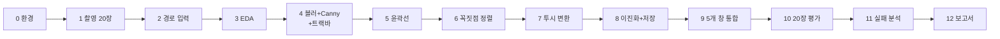

# A3-1 단계별 실습 가이드 — 기울어진 종이를 펴는 문서 스캐너

기준 과제: [A3-1 과제 안내(subject.md)](../subject.md)<br>
개념 설명: [개념 정리(LEARNING_GUIDE.md)](LEARNING_GUIDE.md)

이 문서는 환경 준비부터 제출까지 **무엇을 어떤 순서로 만들고, 각 단계에서 무엇을 확인한 뒤 넘어갈지** 안내합니다. 완성 코드는 없습니다. 각 단계는 **목표 / 할 일 / 힌트 / 확인 방법** 순서로 되어 있고, 개념이 막히면 괄호 안의 LEARNING_GUIDE 절을 읽습니다.

> 과제 문서는 파일 이름을 정해 두지 않았습니다. 아래에 나오는 파일·함수 이름은 모두 **권장** 예시이므로 자유롭게 바꿔도 됩니다. 반드시 지켜야 하는 것은 [subject.md](../subject.md)의 기능 요구 사항과 제약 사항입니다.

## 전체 흐름



| 단계 | 결과물 | 관련 요구 사항 |
| --- | --- | --- |
| 0~2 | 실행 환경, 이미지 20장, 조건 기록, 경로 입력 | 기능 1, 최종 결과물 1 |
| 3 | 히스토그램 그래프와 설명 | 기능 2 |
| 4~8 | 전처리 → 엣지 → 윤곽선 → 변환 → 이진화 → 저장 | 기능 3~6 |
| 9 | 5단계 창 + 트랙바가 있는 애플리케이션 | 최종 결과물 1 |
| 10~12 | 성공률 표, 실패 분석, 보고서 | 기능 7, 최종 결과물 4 |

## 0단계. 환경 준비

**목표**: 허용된 라이브러리만으로 OpenCV 창이 뜨는 환경을 만듭니다.

**할 일**
1. Python 3.8 이상인지 확인하고 가상환경을 만듭니다.
2. `pip install opencv-python numpy matplotlib`로 설치합니다(필수: opencv-python>=4.5, numpy>=1.20 / 선택: matplotlib>=3.3, seaborn).
3. 폴더 구조를 잡습니다(권장).

```text
A3-1/
├── subject.md
├── docs/
├── scanner.py        # 메인 앱: 경로 입력 → 5개 창 + 트랙바
├── geometry.py       # 꼭짓점 정렬 등 직접 구현한 기하 함수
├── eda.py            # 히스토그램 분석
├── evaluate.py       # 20장 일괄 처리
├── images/           # 원본 20장
├── conditions.csv    # 촬영 조건 기록
├── results/          # scanned_001.jpg ...
└── REPORT.md         # 분석 보고서
```

**힌트**
- PyTorch, TensorFlow, Keras, Tesseract 같은 패키지는 설치할 필요도, import할 이유도 없습니다. `scipy`, `shapely`도 좌표 정렬·변환에는 쓰지 않습니다.
- `opencv-python`과 `opencv-contrib-python`, `opencv-python-headless`를 동시에 설치하면 서로 충돌합니다. 하나만 둡니다. `headless`는 GUI 창이 뜨지 않습니다.

**확인 방법**
- `python -c "import cv2, numpy; print(cv2.__version__, numpy.__version__)"`이 4.5 이상, 1.20 이상을 출력합니다.
- 아무 이미지 한 장을 `cv2.imshow` + `cv2.waitKey(0)`으로 띄워 창이 보입니다. 창이 안 뜨면 로컬 데스크톱 환경인지, headless 패키지가 깔려 있지 않은지 확인합니다.

## 1단계. 데이터 수집과 촬영 조건 기록

**목표**: 평가에 쓸 20장과 그 조건표를 만듭니다. (LEARNING_GUIDE 11절)

**할 일**
1. 스마트폰으로 문서 사진 20장을 찍습니다. 쉬운 케이스 5장(단순 배경, 정면, 균일 조명) + 어려운 케이스 15장.
2. 보고서 1번 표가 `단순 배경 + 정면 / 그림자 있음 / 45도 이상 기울어짐 / 복잡한 배경` 각 5장이므로, 어려운 15장을 그림자 5, 45도 이상 5, 복잡한 배경 5로 나누면 표가 바로 채워집니다. 구겨짐, 부분 가림, 빛 반사는 이 안에 섞어 찍어 다양성을 더합니다.
3. 영수증, A4, 명함 등 종류를 섞습니다.
4. 사진마다 조명, 각도, 배경 복잡도를 기록합니다.

```text
file,group,lighting,angle,background,note
easy_01.jpg,단순+정면,균일,0도,단순(검은 책상),A4
shadow_03.jpg,그림자,손 그림자 절반,20도,단순,영수증
```

**힌트**
- 촬영이 어렵다면 LMS의 표준 테스트셋 `cv19_test_images.zip`(20장)을 씁니다. 직접 찍은 추가 이미지는 보너스 가점입니다.
- 파일 이름에 조건을 넣어 두면(`shadow_03.jpg`) 평가 단계에서 조건별 집계가 쉽습니다.
- "45도 이상 기울어짐"은 종이를 화면 안에서 돌린 것인지, 비스듬히 위에서 찍은 것인지 기록에 구분해 둡니다. 실패 원인이 다릅니다.

**확인 방법**
- `images/`에 20장, 조건표에 20행이 있습니다. 그룹별 장수가 5/5/5/5인지 셉니다.

## 2단계. 이미지 경로 입력과 배열 확인

**목표**: "사용자가 이미지 경로를 입력하면 즉시 동작"하는 입구를 만듭니다. (LEARNING_GUIDE 1절)

**할 일**
1. `scanner.py`에서 경로를 받습니다. `input()`으로 묻거나 `sys.argv` / `argparse`로 받습니다.
2. 읽은 직후 `None` 검사를 하고, 실패하면 이유를 출력하고 종료합니다.
3. `shape`, `dtype`, 최소/최대/평균 밝기를 출력해 봅니다.
4. 너무 큰 사진은 처리용 축소본을 만듭니다(권장). 축소 비율을 변수로 보관합니다.

**힌트**

```python
def load_image(path):
    """경로를 받아 BGR 배열을 돌려준다. 실패하면 None."""
    pass  # TODO: cv2.imread, None 검사

def resize_for_processing(image, target_height=800):
    """축소본과 축소 비율을 함께 돌려준다."""
    pass  # TODO: 비율 = target_height / 원본 높이
```

- `cv2.resize`의 크기 인자는 `(너비, 높이)` 순서입니다.
- Windows에서 한글 경로를 못 읽으면 `cv2.imdecode(np.fromfile(path, np.uint8), cv2.IMREAD_COLOR)`를 씁니다.

**확인 방법**
- 잘못된 경로를 넣으면 프로그램이 죽지 않고 안내 문구를 보여 줍니다.
- 올바른 경로에서 `(H, W, 3) uint8`이 출력되고, 축소본의 세로가 800 근처입니다.

## 3단계. 이미지 탐색적 분석 (EDA)

**목표**: 쉬운/어려운 케이스의 밝기 분포 차이를 그래프와 문장으로 남깁니다. (LEARNING_GUIDE 3절)

**할 일**
1. `eda.py`에서 20장을 순회하며 그레이스케일 히스토그램을 구합니다.
2. 이미지별 평균, 표준편차를 표로 저장합니다.
3. 쉬운 5장과 어려운 15장(또는 조건별 4그룹)의 **정규화 히스토그램**을 한 그래프에 겹쳐 그립니다.
4. 그래프를 이미지 파일로 저장하고, "왜 어두운 이미지에서 엣지 검출이 어려운지"를 3~5문장으로 씁니다.

**힌트**
- `np.histogram(gray, bins=256, range=(0, 256))` 결과를 `gray.size`로 나누면 크기가 다른 사진끼리 비교할 수 있습니다.
- 시각화는 Matplotlib/Seaborn 사용이 허용됩니다. `plt.savefig`로 저장해 보고서에 넣습니다.
- 설명에는 숫자를 넣습니다. 예: "쉬운 케이스 평균 표준편차 ○○, 어두운 케이스 ○○ → 대비가 ○배 작습니다."

**확인 방법**
- 그래프에서 쉬운 케이스의 분포가 더 넓게 퍼져 있거나 봉우리 두 개가 뚜렷한지 눈으로 확인합니다. 예상과 다르면 그 이유도 기록합니다(예상과 다른 결과도 좋은 분석 재료입니다).

## 4단계. 전처리, Canny, 트랙바

**목표**: 블러 강도와 Canny low/high를 트랙바로 바꾸며 엣지 결과를 실시간으로 봅니다. (LEARNING_GUIDE 2, 4, 5, 10절)

**할 일**
1. 그레이스케일 변환 → `cv2.GaussianBlur` → `cv2.Canny` 순으로 함수 두 개를 만듭니다.
2. 트랙바 3개(Blur Kernel, Canny Low, Canny High)를 만듭니다.
3. 루프 안에서 트랙바 값을 읽어 Preprocessed, Edges 창을 갱신합니다.

```python
def preprocess(image, ksize):
    """BGR → Gray → GaussianBlur. ksize는 양의 홀수."""
    pass

def detect_edges(blurred, low, high):
    pass
```

**힌트**
- 트랙바 최솟값은 0입니다. `ksize = 2 * pos + 1`로 홀수를 보장합니다.
- 콜백 인자는 필수입니다. `lambda v: None`을 넘기고 루프에서 `getTrackbarPos`로 읽습니다.
- 처음에는 `ksize=5, low=50, high=150` 근처에서 시작해 봅니다.
- `cv2.waitKey`를 호출하지 않으면 창이 갱신되지 않습니다.

**확인 방법**
- 블러를 키우면 책상 무늬와 글씨 엣지가 줄어들고, `high`를 올리면 선이 끊기기 시작하는 것을 직접 봅니다.
- 쉬운 사진에서 종이 외곽선이 **끊김 없이 닫힌 선**으로 보이는 설정을 찾습니다. 찾은 값을 적어 둡니다.

## 5단계. 문서 윤곽선 추출

**목표**: 엣지 이미지에서 꼭짓점 4개짜리 문서 후보를 찾아 원본 위에 그립니다. (LEARNING_GUIDE 6절)

**할 일**
1. `cv2.findContours`로 윤곽선을 찾습니다(OpenCV 4.x는 반환값 2개).
2. 면적이 작은 윤곽선을 버립니다(면적 필터링).
3. 면적 큰 순으로 보며 `cv2.approxPolyDP`로 근사해 꼭짓점이 4개인 첫 후보를 고릅니다.
4. 찾은 사각형을 원본 복사본 위에 빨간색으로 그려 Contours 창에 띄웁니다. 못 찾으면 "문서 미검출" 문구를 그립니다.

```python
def find_document_contour(edges, min_area_ratio=0.05, eps_ratio=0.02):
    """꼭짓점 4개 배열 (4, 2)을 돌려준다. 못 찾으면 None."""
    pass
```

**힌트**
- 허용 오차는 `eps_ratio * cv2.arcLength(c, True)`.
- `approxPolyDP` 결과 모양은 `(4, 1, 2)`입니다. `reshape(4, 2)`로 다루기 쉽게 바꿉니다.
- 외곽선이 1~2픽셀 끊겨 닫히지 않으면 엣지에 `cv2.dilate`를 한 번 적용해 보는 방법이 있습니다(권장).
- 원본 위에 그릴 때는 `image.copy()`에 그립니다. 원본에 그리면 다음 단계 변환 결과에 빨간 선이 찍힙니다.

**확인 방법**
- 쉬운 5장 모두에서 빨간 사각형이 종이 모서리에 맞게 그려집니다.
- 일부러 면적 필터 비율이나 `eps_ratio`를 크게/작게 바꿔 결과가 어떻게 달라지는지 메모합니다(보고서 2~4번 재료).

## 6단계. 꼭짓점 정렬 직접 구현

**목표**: 임의 순서의 4점을 좌상-우상-우하-좌하로 정렬하는 함수를 라이브러리 없이 만듭니다. (LEARNING_GUIDE 7절)

**할 일**
1. `geometry.py`에 `order_points(pts)`를 만듭니다. 입력 `(4, 2)`, 출력 `(4, 2)` `float32`.
2. 좌표 합/차 방식 또는 무게중심-각도 방식 중 하나로 구현합니다.
3. 손으로 만든 좌표로 먼저 테스트한 뒤 실제 이미지에 연결합니다.

```python
def order_points(pts):
    """pts: (4, 2) 임의 순서 → (4, 2) [TL, TR, BR, BL] float32"""
    pass
```

**힌트**
- 허용: `sorted()`, `np.argsort`, `np.sum`, `np.diff`, `np.arctan2`. 금지: `scipy.spatial`, `shapely`.
- 이미지 좌표계는 y가 아래로 커집니다. 손 계산으로 TL의 $x+y$가 가장 작은지 직접 확인해 봅니다.
- 45도로 돌린 마름모 좌표(LEARNING_GUIDE 7절 예시)를 반드시 테스트 입력에 넣습니다.

**확인 방법**
- 아래 입력에서 기대 출력이 나오는지 `assert`로 확인합니다.
  - 입력 `[(420, 80), (100, 120), (450, 500), (80, 460)]` → `[(100, 120), (420, 80), (450, 500), (80, 460)]`
  - 같은 4점을 순서만 섞어 넣어도 결과가 같습니다.
  - 마름모 `[(300, 100), (500, 300), (300, 500), (100, 300)]`에서 같은 점이 두 번 나오지 않고 시계 방향입니다.
- Contours 창에 정렬된 점마다 `0, 1, 2, 3` 번호를 `cv2.putText`로 써서 좌상부터 시계 방향인지 눈으로 확인합니다.

## 7단계. 투시 변환

**목표**: 정렬된 4점으로 문서를 정면에서 본 직사각형으로 폅니다. (LEARNING_GUIDE 8절)

**할 일**
1. 결과 크기 `W, H`를 정합니다. 처음에는 고정값(예: A4 비율 1:1.414)으로 시작합니다.
2. 목적지 4점을 `[[0,0],[W-1,0],[W-1,H-1],[0,H-1]]` 순서로 만듭니다.
3. `cv2.getPerspectiveTransform(src, dst)` → `cv2.warpPerspective(image, M, (W, H))`.

```python
def warp_document(image, ordered_pts, width, height):
    pass  # TODO: src/dst는 float32, 같은 순서
```

**힌트**
- 축소본에서 꼭짓점을 찾았다면 좌표를 축소 비율로 나눠 **원본 해상도**에서 변환하면 글씨가 선명합니다(권장).
- 결과가 거울처럼 뒤집히면 src와 dst의 순서가 다릅니다. 결과가 나비넥타이처럼 꼬이면 정렬이 틀렸습니다.
- `dsize`는 `(너비, 높이)` 순서입니다.

**확인 방법**
- 비스듬한 A4 사진이 반듯한 직사각형으로 펴지고, 글줄이 수평입니다.
- 배경(책상)이 결과 가장자리에 거의 남지 않습니다.

## 8단계. 적응형 이진화와 저장

**목표**: 변환된 문서를 깔끔한 흑백 스캔본으로 만들어 파일로 저장합니다. (LEARNING_GUIDE 9절)

**할 일**
1. 변환 결과를 그레이스케일로 바꾼 뒤 `cv2.adaptiveThreshold`를 적용합니다.
2. `blockSize`(홀수), `C`를 바꿔 가며 그림자 사진에서 글씨가 가장 잘 보이는 값을 찾습니다.
3. 결과를 `results/scanned_001.jpg`처럼 jpg 또는 png로 저장합니다.

**힌트**
- `adaptiveThreshold` 입력은 8비트 1채널이어야 합니다.
- `blockSize` 11~31, `C` 5~15 사이에서 시작해 봅니다. `blockSize`도 트랙바로 만들면 실험이 편합니다(권장, 과제 필수 트랙바는 블러와 Canny).
- `cv2.imwrite`는 실패해도 예외 없이 `False`를 돌려줍니다. 폴더가 없으면 저장이 안 됩니다. 반환값을 확인합니다.

**확인 방법**
- 그림자 있는 사진에서 전역 이진화(`cv2.threshold`)와 적응형 결과를 나란히 비교해, 그림자 영역 글씨가 적응형에서 더 살아 있는지 확인합니다.
- `results/` 폴더에 파일이 생기고, 이미지 뷰어로 열립니다.

## 9단계. 다섯 개 창으로 통합

**목표**: 경로 하나로 원본 → 전처리 → 엣지 → 윤곽선 → 결과 다섯 창이 뜨고, 트랙바 조절이 즉시 반영되는 앱을 완성합니다.

**할 일**
1. 4~8단계 함수를 `scanner.py`의 메인 루프에서 순서대로 호출합니다.
2. 창 이름 5개: Original, Preprocessed, Edges, Contours, Result(결과 예시와 같은 이름 권장).
3. 키 입력으로 저장(예: `s`)과 종료(예: `q`)를 처리합니다(권장).
4. 문서를 못 찾은 프레임에서도 프로그램이 죽지 않게 Result 창에 안내 이미지를 띄웁니다.

**힌트**
- 함수마다 입력·출력을 분리해 두면 10단계 일괄 평가에서 GUI 없이 같은 함수를 재사용할 수 있습니다.
- 창이 너무 크면 `cv2.namedWindow(name, cv2.WINDOW_NORMAL)`로 크기 조절이 가능한 창을 만듭니다.
- GUI가 안 되는 환경(Colab)이라면 각 단계 이미지를 `imwrite`로 저장하고 파라미터를 `argparse` 인자나 설정 파일로 받는 모드를 만듭니다.

**확인 방법**
- 트랙바를 움직이면 Preprocessed, Edges, Contours, Result가 함께 바뀝니다.
- 쉬운 5장 모두에서 처음 실행부터 Result 창에 반듯한 스캔본이 보입니다.

## 10단계. 20장 일괄 평가

**목표**: 20장 전체의 검출 성공 여부를 측정하고 조건별 성공률 표를 만듭니다.

**할 일**
1. `evaluate.py`에서 고정 파라미터로 20장을 모두 처리하고, 각 장의 Contours 이미지와 Result 이미지를 저장합니다.
2. 저장된 이미지를 보고 성공/실패를 직접 판정해 기록합니다. 판정 기준은 "4개의 꼭짓점이 올바르게 검출되어 문서가 반듯하게 변환됨"입니다.
3. 조건별(단순+정면, 그림자, 45도 이상, 복잡한 배경) 성공 수와 성공률을 표로 만듭니다.

```text
file,group,detected_4pts,straight_result,success,memo
shadow_03.jpg,그림자,Y,N,N,그림자 경계를 변으로 잡음
```

**힌트**
- "4점은 나왔는데 엉뚱한 사각형"은 실패입니다. 자동 판정(4점이 나왔는가)과 사람 판정(맞는 4점인가)을 별도 열로 두면 분석이 쉽습니다.
- 사용한 파라미터 값을 결과와 함께 기록합니다. 파라미터가 바뀌면 성공률도 바뀝니다.

**확인 방법**
- 20행이 모두 채워져 있고, 조건별 합계가 5씩입니다.
- 성공률 = 성공 수 / 5 × 100으로 계산되어 보고서 1번 표 형식과 일치합니다.

## 11단계. 실패 분석과 파라미터 실험

**목표**: 실패 3건 이상의 원인을 분석하고, "단일 최적 파라미터가 있는가"에 데이터로 답합니다. (LEARNING_GUIDE 11, 12절)

**할 일**
1. 실패 사례마다 Edges, Contours 창을 다시 보며 어느 단계에서 무너졌는지 찾습니다.
2. 파라미터를 조정해 보고 "시도 → 결과"를 기록합니다.
3. 파라미터 조합 3~4개로 20장을 다시 돌려 조합별 성공 표를 만듭니다.
4. 이미지 A에서 최적인 값이 이미지 B에서 실패하는 쌍을 하나 이상 찾습니다.

| 파라미터 조합 | 단순+정면 | 그림자 | 45도 이상 | 복잡한 배경 | 전체 |
| --- | --- | --- | --- | --- | --- |
| blur 5 / 50 / 150 | ?/5 | ?/5 | ?/5 | ?/5 | ?/20 |
| blur 9 / 30 / 90 | ?/5 | ?/5 | ?/5 | ?/5 | ?/20 |

**힌트**
- 실패 원인 기록 형식: 증상 / 의심 단계 / 원인 가설 / 시도한 조정 / 결과 / 결론.
- 규칙을 하나 추가해 실패를 고쳤다면, 그 규칙 때문에 새로 실패한 사진이 있는지도 확인합니다. 이 경험이 보고서 4번입니다.

**확인 방법**
- 최소 3건의 실패 분석이 완성되어 있습니다.
- 조합별 표에서 모든 조건을 동시에 만족하는 조합이 있는지 없는지 숫자로 말할 수 있습니다.

## 12단계. 분석 보고서 작성

**목표**: subject.md의 보고서 요구 사항 5개 항목을 모두 채웁니다.

**할 일** (권장 파일: `REPORT.md`)

| 보고서 항목 | 들어갈 내용 | 출처 단계 |
| --- | --- | --- |
| 1. 테스트 결과 요약 | 조건 / 테스트 수 / 성공 / 실패 / 성공률 표 | 10단계 |
| 2. 실패 원인 분석 | 실패 케이스별 원인, 시도한 조정과 결과 | 11단계 |
| 3. 파라미터 딜레마 | 조합별 성공 표, A의 최적이 B에서 실패하는 이유 | 11단계 |
| 4. 규칙 기반의 한계 | 설계한 규칙 목록, 규칙별 실패 상황, 규칙 추가 경험 | 5~11단계 |
| 5. 학습 기반 접근이 필요한 이유 | 경험을 근거로 한 가설 | 전체 |

**힌트**
- EDA 결과(3단계 그래프와 설명)와 촬영 조건표도 함께 넣으면 보고서 근거가 단단해집니다.
- 성공·실패 대표 이미지(Contours, Result)를 넣습니다.
- 결론은 "딥러닝이 좋다"가 아니라 "내 실패 ○건은 ○○ 때문이었고, 다양한 데이터로 학습하면 ○○가 달라질 것이다"처럼 자신의 데이터에서 출발합니다.

**확인 방법**
- 다섯 항목 제목이 모두 있고, 1번 표의 빈칸(`?`)이 하나도 없습니다.

## 선택 기능: 웹캠 보드

**목표**: 실시간 프레임에서 문서 윤곽선을 표시하고 키로 캡처/종료합니다.

**할 일**
1. `cv2.VideoCapture(0)`으로 카메라를 엽니다. `isOpened()`로 확인합니다.
2. 프레임마다 4~5단계 함수를 호출해 윤곽선을 그립니다.
3. `s` 키: 현재 프레임에서 변환 + 이진화 결과를 저장. `q` 키: 루프 종료 후 `release()`, `destroyAllWindows()`.

**힌트**
- 매 프레임 처리가 느리면 프레임을 축소해서 검출합니다.
- macOS는 터미널/IDE에 카메라 권한을 줘야 합니다. 권한이 없으면 `read()`가 계속 `False`를 돌려줍니다.

**확인 방법**
- `q`를 눌렀을 때 창이 닫히고 프로세스가 정상 종료됩니다. `s`로 저장한 파일이 열립니다.

## 보너스 과제 (선택)

### 보너스 1. 컨볼루션 직접 구현
- 힌트: 가우시안 커널을 식으로 만들고 합이 1이 되게 정규화합니다. `np.pad(mode="reflect")`로 경계를 채웁니다.
- 이중 for문 버전과 벡터화 버전(커널 칸마다 밀어 놓은 배열 누적, 또는 `sliding_window_view`) 두 가지를 만듭니다.
- `time.perf_counter()`로 같은 이미지에서 여러 번 잰 평균을 표로 비교하고, `cv2.GaussianBlur` 결과와 최대 오차도 함께 적습니다.
- 큰 사진으로 for문 버전을 돌리면 매우 오래 걸립니다. 작은 크기(예: 200x200)로 비교합니다.
- 참고: LEARNING_GUIDE 13-1절.

### 보너스 2. 종횡비 자동 보정
- 힌트: 정렬된 꼭짓점의 마주 보는 두 변 길이 중 긴 쪽을 각각 W, H로 씁니다.
- 고정 크기 결과와 자동 크기 결과를 나란히 저장해 실제 문서 비율(A4 1:1.414, 명함 등)과 오차를 % 로 비교합니다.
- 참고: LEARNING_GUIDE 13-2절.

### 보너스 3. PDF 내보내기
- 이 보너스에 한해 Pillow, FPDF, reportlab 등 PDF 라이브러리 사용이 허용됩니다.
- 힌트: NumPy 배열 → Pillow 이미지 → PDF 저장. 컬러라면 BGR → RGB 변환을 잊지 않습니다.

## 자주 막히는 지점

| 증상 | 원인 | 해결 방향 |
| --- | --- | --- |
| `'NoneType' object has no attribute 'shape'` | `imread` 경로 오류 | 경로 출력, `None` 검사, 한글 경로 우회 |
| 창이 회색이거나 응답 없음 | `waitKey` 미호출 | 루프마다 `waitKey` 호출 |
| `GaussianBlur` 에러 (ksize) | 짝수 또는 0 커널 | `2 * pos + 1` |
| `findContours` 반환값 개수 에러 | 3.x 예제를 4.x에서 실행 | 반환값 2개로 받기 |
| 사각형을 못 찾음 | 외곽선이 끊김, `eps` 부적절 | Edges 창 확인, 블러/임계값, dilate |
| 엉뚱한 큰 사각형 선택 | 후보 선택 규칙 | 면적 상위 후보 여러 개 그려 보기 |
| 결과가 뒤집히거나 꼬임 | 꼭짓점 순서 불일치 | 번호 표시, `order_points` 단위 테스트 |
| 결과가 눌려 보임 | `dsize`에 `(H, W)` 전달 | `(W, H)` 순서 |
| 이진화 결과가 온통 검음/흰색 | `C`, `blockSize` 부적절, 3채널 입력 | 그레이스케일 확인, 값 조절 |
| Matplotlib 색이 이상함 | BGR/RGB 순서 | `cvtColor(..., COLOR_BGR2RGB)` |

## 최종 자가 점검표

제출 전에 [subject.md](../subject.md)의 각 요구 사항을 하나씩 확인합니다.

| 요구 사항 | 어디서 확인하는지 |
| --- | --- |
| 이미지 경로 입력 시 즉시 동작 | `scanner.py` 실행 → 경로 입력 → 창이 뜸 (2, 9단계) |
| 원본 → 전처리 → 엣지 → 윤곽선 → 결과 단계별 창 | 실행 화면의 창 5개 (9단계) |
| 트랙바로 블러 강도, Canny low/high 실시간 조절 | 트랙바 3개 조작 시 화면 갱신 (4단계) |
| 복잡한 배경에서 문서 자동 검출 | Contours 창, 복잡한 배경 5장 결과 (5, 10단계) |
| 비스듬한 문서를 직사각형으로 변환 | Result 창, 45도 이상 5장 결과 (7, 10단계) |
| 적응형 이진화 적용 | `adaptiveThreshold` 호출부, 그림자 사진 결과 (8단계) |
| 결과물 jpg/png 저장 | `results/` 폴더 (8단계) |
| 20장 촬영(쉬운 5 + 어려운 15) 또는 표준 테스트셋 | `images/` 20장 (1단계) |
| 이미지별 촬영 조건 기록 | 조건표 (1단계) |
| 픽셀 히스토그램 분석, 쉬운/어려운 비교 시각화 | EDA 그래프 파일 (3단계) |
| 어두운 이미지 엣지 검출 난이도 설명(분포 관점) | 보고서 또는 EDA 설명 (3단계) |
| Grayscale + 가우시안 블러 + Canny | `preprocess`, `detect_edges` (4단계) |
| 닫힌 윤곽선, 면적 필터링, `approxPolyDP` 4점, 원본 위 시각화 | `find_document_contour`, Contours 창 (5단계) |
| 4점 정렬(좌상-우상-우하-좌하) 직접 구현 | `order_points`와 단위 테스트 (6단계) |
| `getPerspectiveTransform` + `warpPerspective` | `warp_document` (7단계) |
| 20장 검출 성공 여부 측정, 조건별 성공률 표 | 평가 기록, 보고서 1번 (10단계) |
| 실패 케이스 3건 이상 원인 분석 | 보고서 2번 (11단계) |
| 파라미터 딜레마, 규칙 기반 한계, 학습 기반 가설 | 보고서 3~5번 (11, 12단계) |
| 웹캠 보드: 실시간 검출, `s` 저장, `q` 종료 (선택) | 웹캠 실행 (선택 기능) |
| 금지 라이브러리 미사용 (딥러닝 프레임워크, OCR, scipy.spatial, shapely) | 모든 `.py`의 import 목록 검색 |
| Python 3.8+, opencv-python>=4.5, numpy>=1.20 | 0단계 버전 출력 |
